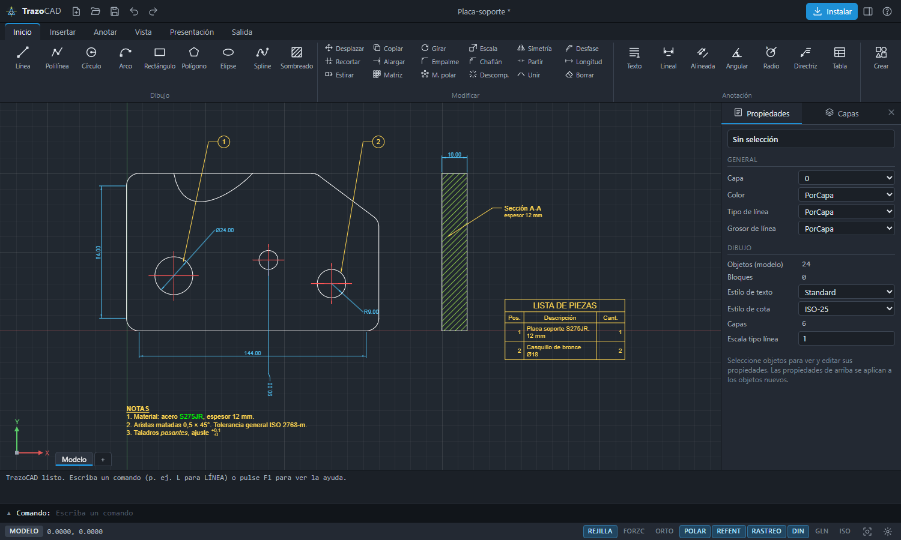
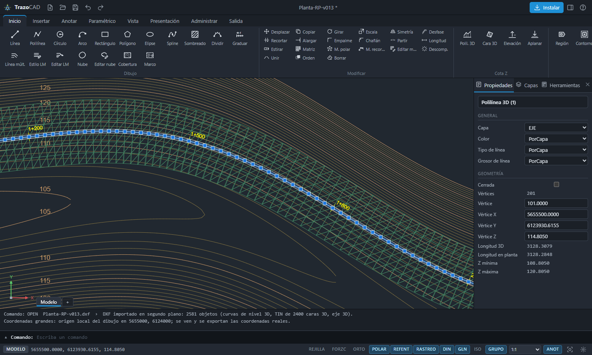
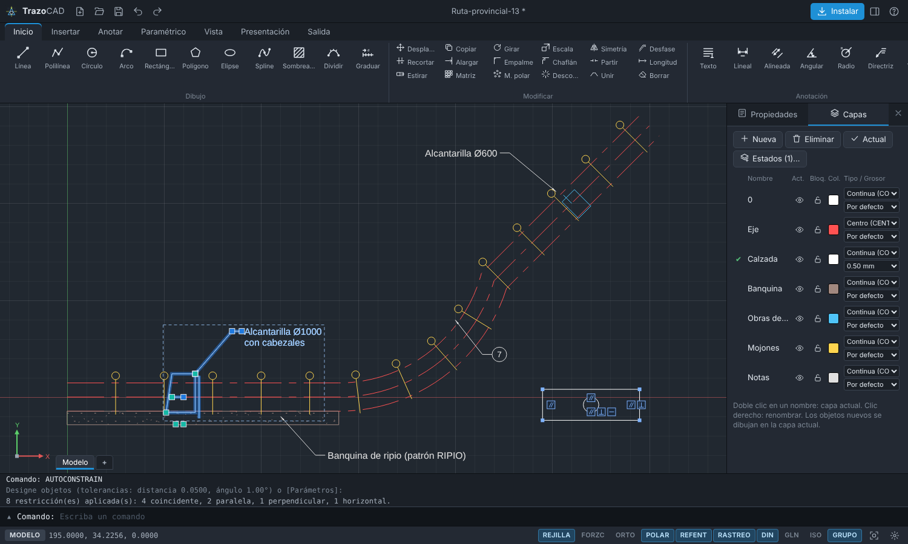
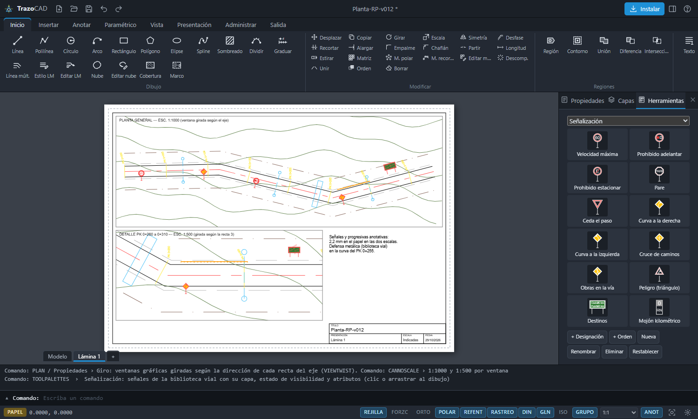
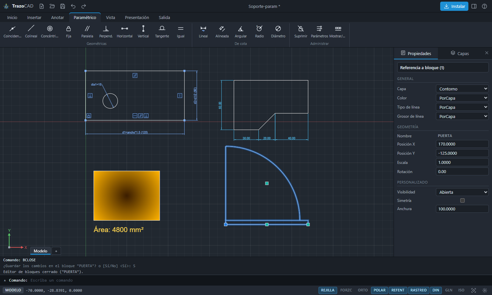
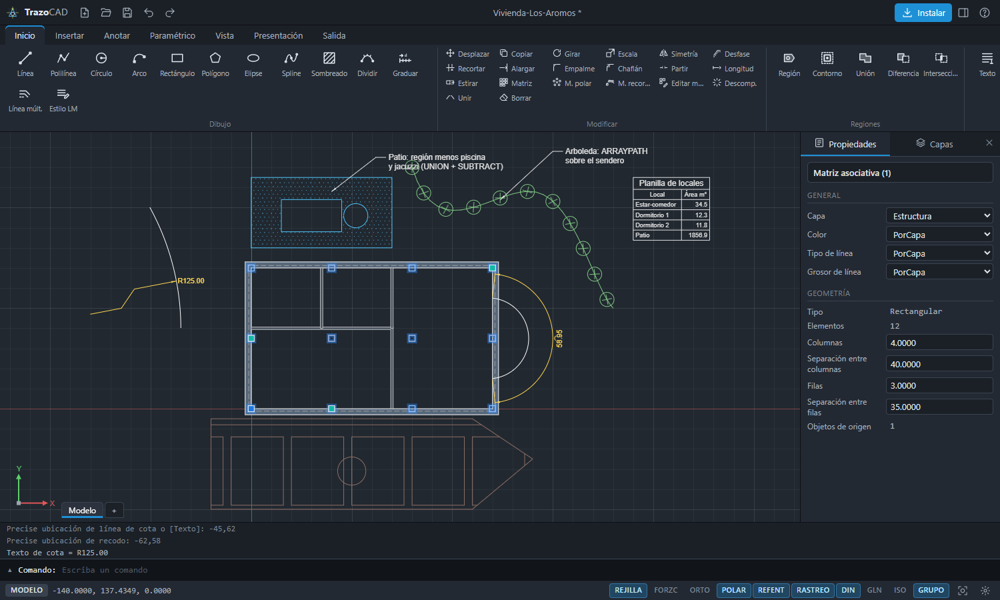
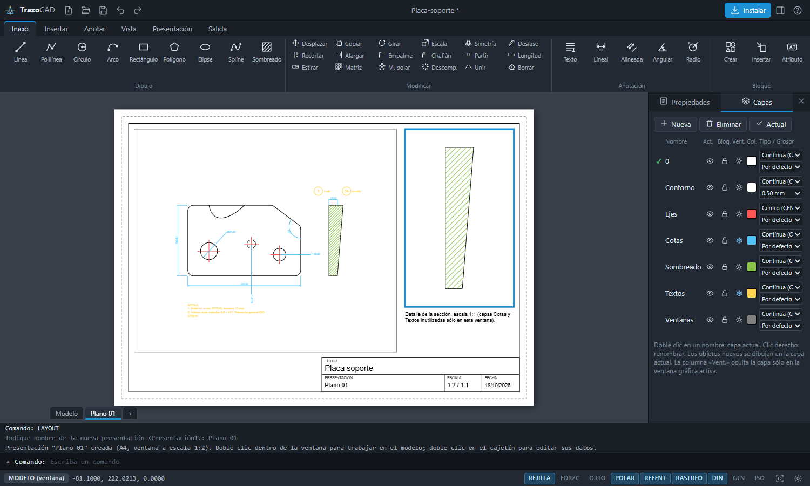

# TrazoCAD

### A 2D CAD application in the browser, written from scratch

AutoCAD-style technical drawing as an installable, offline web app (PWA).
**Pure JavaScript, zero dependencies, no build step.**

*This is a showcase repository. The source code is private; this page shows what the program does and how it was built.*

---

## Why I built it

I spent years drafting architecture and engineering projects in AutoCAD, and today I work with road networks. TrazoCAD started as a challenge: could one person, working with AI agents, build a real CAD program — one that a draftsman would recognise — without a single external library?

Thirteen versions later it reads and writes DXF, handles real survey coordinates and 3D terrain surfaces, and is heading towards a **CAD + GIS tool for road engineering**.

## What it does

**Drawing like AutoCAD**
- Command line with AutoCAD command names (LINE, PLINE, OFFSET, TRIM, HATCH, DIMLINEAR…) and Spanish aliases — more than 180 commands.
- Object snaps, polar tracking, layers, blocks with attributes and dynamic blocks, dimensions, multileaders, tables, hatches and gradients.
- Parametric constraints, geometric and dimensional.
- Paper space: layouts, rotated viewports, annotative scales, plot styles and PDF output.

**Files**
- Reads and writes **DXF** (2007, 2000 and R12), including 3D polylines, 3D faces and the **TIN surfaces** produced by surveying software.
- Its own `.tcad` format, with every earlier version still readable.

**Built for real engineering data**
- **Large coordinates** (Gauss-Krüger, UTM) with a local drawing origin, so precision holds at any zoom while the user always sees and exports the real values.
- Elevation (Z) on every object, 3D polylines for contour lines, 3D faces for terrain.
- Handles **more than 100,000 objects**: incremental undo, a spatial index and cached rendering — one command went from 270 ms to 2 ms.
- A road-engineering block library: signage, culverts, safety barriers, drainage.

**Automation**
- `.scr` scripts and action recording, and a **JavaScript API** to create, query and modify drawings.

---

## Screenshots

### Road plan from a real DXF
Contour lines as 3D polylines and a TIN surface of 2,400 faces along the road axis, in Gauss-Krüger coordinates.

### Road works drawing
Culverts, gravel shoulder and the road axis, with layers and the object properties palette.

### Layout sheet with rotated viewports
An A3 sheet with two viewports rotated along the road axis (1:1000 and 1:500), road signs from the block library and annotative chainages that keep the same size on paper at both scales.

### Parametric design and blocks

| | |
|---|---|
|  |  |
| Geometric and dimensional constraints | Floor plan with associative arrays and a schedule |

### Plotting

---

## How it was built

Built by one person with **AI agents (Claude Code) as the main development tool**, in versions: each one closes with a roadmap for the next.

- **~22,000 lines** of JavaScript in ES modules — no frameworks, no libraries.
- **About 30 automated tests** run the program in headless Chrome: they execute commands, export DXF and PDF, and check the results. Every version ships with new tests and a new screenshot made by script.
- A project guide records how the work is done and the pitfalls found along the way, so each session builds on the last.

## Where it's going

The roadmap to v1.0 turns TrazoCAD into **CAD + GIS for road engineering**, following the Civil 3D workflow:

| Stage | Content |
|---|---|
| GIS | Projection engine with datums, georeferenced drawings, base maps, GeoJSON / Shapefile / KML / GeoTIFF, attribute tables and geoprocessing |
| Surveying | Point import, traverses, TIN surfaces with breaklines, contours |
| Road design | Horizontal alignments with spirals, vertical profiles, superelevation, assemblies and corridors |
| Earthworks | Cross sections, cut and fill volumes, mass haul diagram |
| Production | Automatic plan-and-profile sheets and batch PDF publishing |

Design standards are data, not code: any country's rules can be loaded from a file.

---

**Matías Rosello** · [GitHub](https://github.com/rikochet87) · rosellomatias87@gmail.com

